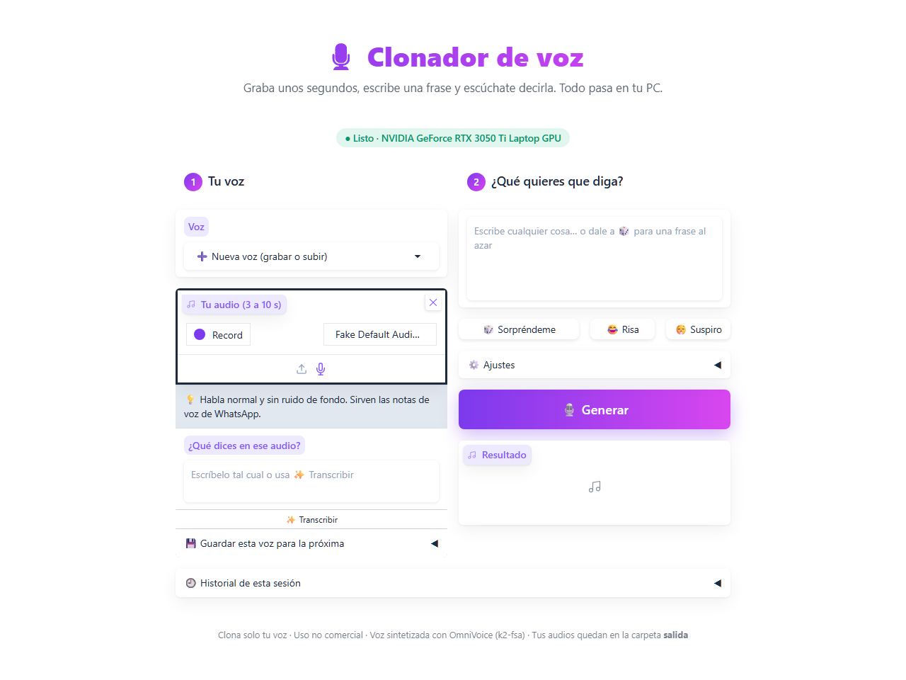

<div align="center">

# 🎙️ Clonador de voz

**Graba unos segundos de tu voz, escribe cualquier frase y escúchate diciéndola.**
Todo pasa en tu PC: tus audios no se suben a ningún lado.




</div>

---

## ⚡ Instálalo en 3 pasos

> **Antes:** instala [Python](https://www.python.org/downloads/) y, en la primera pantalla del instalador, marca ✅ **«Add python.exe to PATH»**.

| | Paso | Qué haces |
|:-:|---|---|
| 1️⃣ | **Descarga** | Arriba en esta página: botón verde **Code → Download ZIP**, y descomprímelo donde quieras. |
| 2️⃣ | **Instala** | Doble clic en **`instalar.bat`**. Se hace **una sola vez** y tarda de 10 a 30 min (baja ~8 GB). |
| 3️⃣ | **Abre** | Doble clic en **«Clonador de voz»** en tu escritorio. El navegador se abre solo. |

Eso es todo. 🎉

---

## 🎛️ Cómo se usa

**1 · Tu voz**
- Dale a 🎤 y **graba de 3 a 10 segundos** hablando normal, o **sube un audio** (sirven las notas de voz de WhatsApp).
- Pulsa **✨ Transcribir** para que escriba solo lo que dijiste. Revísalo: tiene que coincidir palabra por palabra.
- Opcional: **💾 Guarda la voz** con un nombre y la próxima vez solo la eliges de la lista.

**2 · ¿Qué quieres que diga?**
- Escribe lo que sea, o dale a **🎲 Sorpréndeme** para una frase al azar.
- Mete **😂 Risa** o **😮‍💨 Suspiro** donde quieras dentro del texto.

**3 · 🎙️ Generar**
- Suena solo. Lo descargas desde el reproductor y queda guardado en la carpeta **`salida`**.
- Si una frase sale rara, abre **⚙️ Ajustes**, toca el **🎲** de *Variación* y genera otra vez.

---

## 💡 Para que suene igualito a ti

- 🔇 **Silencio total de fondo**: sin música, sin tele y sin gente hablando.
- 🗣️ **Habla como quieres que hable el clon.** Si grabas susurrando, el clon susurra.
- ⏱️ **De 3 a 10 segundos** es lo ideal. Más largo no mejora y a veces empeora.
- 🎧 Con un **micrófono de audífonos** suele salir mejor que con el del portátil.
- ✍️ El texto de la referencia tiene que ser **exacto**. Es lo que más se nota.

---

## 🧰 Qué necesitas

| | Mínimo | Ideal |
|---|---|---|
| Sistema | Windows 10 | Windows 11 |
| Tarjeta gráfica | Ninguna (va por CPU, ~minutos por frase) | NVIDIA con 4 GB o más (~40 s por frase) |
| Espacio libre | 10 GB | 15 GB |
| Internet | Solo para instalar | — |

---

## 🆘 Si algo falla

<details>
<summary><b>«No encontré Python»</b></summary>

Instala Python desde [python.org](https://www.python.org/downloads/) marcando **Add python.exe to PATH**, cierra la ventana y vuelve a abrir `instalar.bat`.
</details>

<details>
<summary><b>«CUDA out of memory» o se queda pegado</b></summary>

Cierra juegos, editores de video o el navegador con muchas pestañas. Si tu tarjeta tiene menos de 4 GB, instala en modo CPU: abre una terminal en la carpeta y corre `instalar.bat -CPU`.
</details>

<details>
<summary><b>Sale con otra voz o no se entiende</b></summary>

1. Revisa que el texto de la referencia sea **exacto**.
2. Cambia la **Variación** en ⚙️ Ajustes.
3. Graba otra referencia más limpia, de 5 a 8 segundos.
</details>

<details>
<summary><b>El navegador no se abrió</b></summary>

Mira la ventana negra: dice algo como `http://127.0.0.1:8001`. Copia esa dirección en el navegador.
</details>

<details>
<summary><b>Windows dice «Windows protegió su PC»</b></summary>

Pasa con cualquier `.bat` descargado de internet. Dale a **Más información → Ejecutar de todas formas**. Si prefieres revisar antes qué hace, abre `instalar.bat` e `instalar.ps1` con el Bloc de notas: son cortos y están comentados.
</details>

<details>
<summary><b>¿Cómo lo desinstalo?</b></summary>

Borra la carpeta del proyecto, el acceso directo del escritorio y la caché del modelo en `C:\Users\<tu usuario>\.cache\huggingface`.
</details>

---

<details>
<summary><b>🤓 Modo avanzado: línea de comandos y tandas de frases</b></summary>

<br>

```bat
clonar.bat --ref mis_audios\yo.wav --ref-texto "Lo que digo en el audio" --texto "Hola, soy tu clon"
```

Generar muchas frases de una y guardar la voz:

```bat
clonar.bat --ref mis_audios\yo.wav --ref-texto "..." --guardar-voz mis_voces\yo.pt --frases frases_ejemplo.txt
clonar.bat --voz mis_voces\yo.pt --texto "Ya sin audio de referencia"
```

| Opción | Para qué |
|---|---|
| `--velocidad 0.9` | Más lento (1.0 = normal) |
| `--semilla 3` | Otra variación si sale rara |
| `--pasos 48` | Más calidad, más lento |
| `--idioma english` | Texto en otro idioma |
| `--cpu` | Forzar CPU |

Las voces que guardas desde la app (`mis_voces\*.pt`) también sirven aquí con `--voz`.
</details>

---

## 🤝 Reglas del grupo

1. **Clona solo tu voz.** La de otra persona, únicamente con su permiso explícito.
2. **Nada de hacerte pasar por alguien** ni de hacer audios falsos para engañar o perjudicar.
3. **Uso no comercial**: nada de venderlo ni de usarlo en contenido monetizado (ver licencias).
4. Si publicas algo, da crédito: *«Voz sintetizada con OmniVoice (k2-fsa)»*.
5. **No subas audios ni voces al repo.** El `.gitignore` ya los bloquea.

## 📜 Licencias y créditos

- Motor de voz: [**OmniVoice**](https://github.com/k2-fsa/OmniVoice) de k2-fsa. El código es Apache 2.0 y el **modelo es CC-BY-NC** (no comercial).
- El tokenizador de audio incluido en el modelo es *Boson Higgs Audio 2* (licencia comunitaria).
- Transcripción: [faster-whisper](https://github.com/SYSTRAN/faster-whisper). Interfaz: [Gradio](https://gradio.app).
- El repo **no incluye ningún modelo**: el instalador los baja de sus fuentes oficiales en tu PC.
